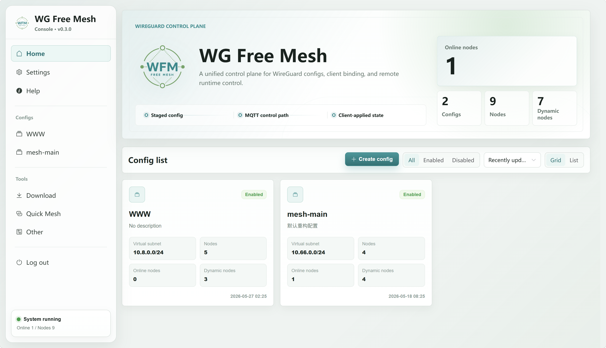

  <a href="./README.md">English</a> · <a href="./README_ZH.md">简体中文</a>

  

<h1 align="center">WG Free Mesh</h1>

  <strong>Your WireGuard network. One control plane.</strong>

  A self-hosted platform for WireGuard and AmneziaWG. 
  Design your mesh, distribute configs, and manage connected nodes from one console.

  
  
  
  

  <a href="https://wfm.xinghenluyus.cn/en/deploy/"><strong>Deploy with Docker</strong></a>
  &nbsp; · &nbsp;
  <a href="https://github.com/xinghenLuyus/wg-free-mesh/releases"><strong>Download Client</strong></a>
  &nbsp; · &nbsp;
  <a href="https://wfm.xinghenluyus.cn/en/"><strong>Documentation</strong></a>

## Less configuration work. More control.

Managing a multi-node network should not mean editing the same peer settings on every machine. WG Free Mesh brings configs, topology, and client operations together, while keeping individual parameters editable when you need precise control.

| Capability | What you can do |
| --- | --- |
| **Visual network management** | Organize configs and endpoints; maintain virtual addresses, peer links, routes, and advanced settings in one place. |
| **Quick Mesh** | Generate gateway, full mesh, or Free Mesh topologies instead of wiring every peer by hand. |
| **WireGuard & AmneziaWG** | Choose WireGuard or AmneziaWG 1.5, 2.0, and 3.1, with configurable parameters and randomization. |
| **Client control** | Bind nodes, push configs, start or stop tunnels, and inspect reported runtime state from the console. |
| **Flexible deployment** | Self-host with Docker on AMD64 or ARM64, using SQLite or PostgreSQL. |
| **Backups & integrations** | Export application snapshots, move data between database modes, and connect AI tools through permission-controlled MCP access. |

Use it to connect servers across locations, manage a gateway-based network, or maintain a mesh that changes as nodes come and go.

## Get started

**Start with the control plane.** Follow the [Docker deployment guide](https://wfm.xinghenluyus.cn/en/deploy/) to choose SQLite or PostgreSQL, configure your environment, and bring up the console.

Then build your network:

1. Create a config and add your nodes.
2. Generate a topology with Quick Mesh or edit peer links yourself.
3. Download configs for manual use, or install and bind clients for centralized control.

[Create your first mesh →](https://wfm.xinghenluyus.cn/en/guide/first-mesh)

**Already have a server?** [Download a client package](https://github.com/xinghenLuyus/wg-free-mesh/releases) for your OS and architecture, then follow the binding instructions in your console. Client packages connect devices to an existing WG Free Mesh server; they do not deploy the control plane.

## How it fits together

The server manages network configuration and sends configs and commands to bound clients. Clients apply them through the WireGuard or AmneziaWG toolchain on each host. For manual operation, you can download configs without enabling remote control.

WG Free Mesh manages your tunnels; it does not replace the underlying tunnel implementation or provide a hosted VPN service.

## Explore

- [Documentation](https://wfm.xinghenluyus.cn/en/) — usage, deployment, protocol reference, and development.
- [Releases](https://github.com/xinghenLuyus/wg-free-mesh/releases) — client packages and release notes.
- [Changelog](./CHANGELOG.md) — concise version highlights in English and Chinese.
- [Issues](https://github.com/xinghenLuyus/wg-free-mesh/issues) — report bugs or suggest improvements.

## License

Licensed under [Apache License 2.0](./LICENSE).
