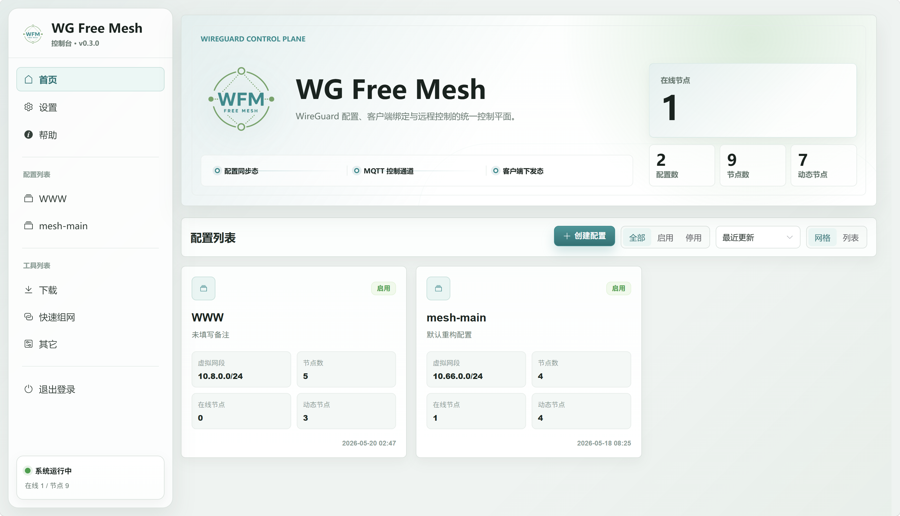

  <a href="./README.md">English</a> · <a href="./README_ZH.md">简体中文</a>

  

<h1 align="center">WG Free Mesh</h1>

  <strong>一个控制台，掌控你的 WireGuard 网络。</strong>

  面向 WireGuard 与 AmneziaWG 的自托管管理平台。 
  可视化组网、统一分发配置、集中管理客户端节点。

  
  
  
  

  <a href="https://wfm.xinghenluyus.cn/deploy/"><strong>Docker 部署</strong></a>
  &nbsp; · &nbsp;
  <a href="https://github.com/xinghenLuyus/wg-free-mesh/releases"><strong>下载客户端</strong></a>
  &nbsp; · &nbsp;
  <a href="https://wfm.xinghenluyus.cn/"><strong>使用文档</strong></a>

## 少一点重复配置，多一点掌控。

维护多节点网络，不应该意味着在每台机器上反复修改 Peer 参数。WG Free Mesh 将配置、网络拓扑和客户端操作集中到一个控制台，同时保留各项参数的独立编辑能力，让自动化与精细控制兼得。

| 能力 | 你可以做什么 |
| --- | --- |
| **可视化网络管理** | 集中组织配置和端点，维护虚拟地址、Mesh 连接、路由及高级参数。 |
| **快速组网** | 生成网关网络、全连接网络或 Free Mesh，无需逐一手写所有 Peer 连接。 |
| **WireGuard 与 AmneziaWG** | 选择 WireGuard 或 AmneziaWG 1.5、2.0、3.1，自主配置参数或使用随机生成。 |
| **客户端控制** | 绑定节点、下发配置、启停隧道，并查看客户端上报的运行状态。 |
| **灵活部署** | 使用 Docker 在 AMD64 或 ARM64 上自托管，支持 SQLite 和 PostgreSQL。 |
| **备份与集成** | 导出应用级快照、在两种数据库之间迁移数据，通过权限受控的 MCP 接入 AI 工具。 |

无论是连接不同地点的服务器、搭建以网关为中心的网络，还是维护节点经常增减的 Mesh，都可以从这里开始。

## 快速开始

**先部署控制台。** 按照 [Docker 部署指南](https://wfm.xinghenluyus.cn/deploy/)选择 SQLite 或 PostgreSQL，配置环境并启动服务。

然后建立你的网络：

1. 创建配置，添加节点。
2. 使用快速组网生成拓扑，或自行维护 Mesh 连接。
3. 下载配置手动使用，或安装并绑定客户端，交由控制台统一管理。

[创建第一个 Mesh →](https://wfm.xinghenluyus.cn/guide/first-mesh)

**已经有服务端？** [下载客户端安装包](https://github.com/xinghenLuyus/wg-free-mesh/releases)，选择对应系统与架构，按照控制台中的说明完成绑定。客户端用于将设备接入已有的 WG Free Mesh 服务端，不包含控制台部署。

## 如何协作

服务端管理网络配置，并向已绑定客户端下发配置和命令。客户端通过各台主机上的 WireGuard 或 AmneziaWG 工具链应用配置。如果偏好手动管理，也可以直接下载配置，不启用远程控制。

WG Free Mesh 负责管理隧道，不替代底层隧道实现，也不提供托管 VPN 服务。

## 更多入口

- [使用文档](https://wfm.xinghenluyus.cn/)：使用指南、部署说明、协议参考与开发文档。
- [版本发布](https://github.com/xinghenLuyus/wg-free-mesh/releases)：客户端安装包与发布说明。
- [更新日志](./CHANGELOG.md)：中英双语的版本变化摘要。
- [问题反馈](https://github.com/xinghenLuyus/wg-free-mesh/issues)：报告问题或提出建议。

## 许可证

本项目采用 [Apache License 2.0](./LICENSE) 许可证。
